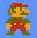
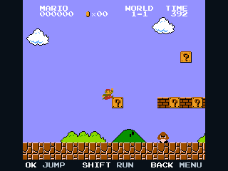
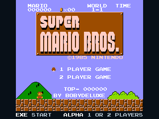
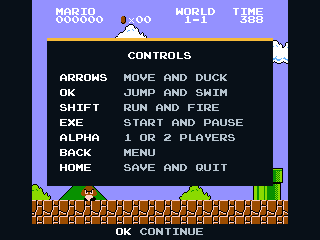
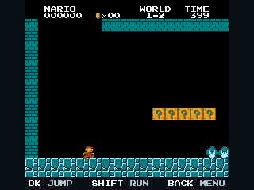
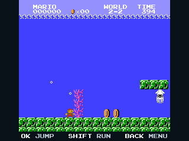
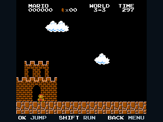
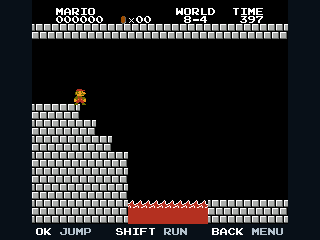
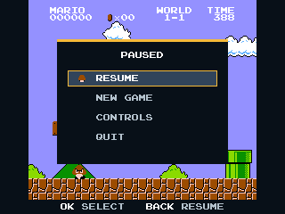
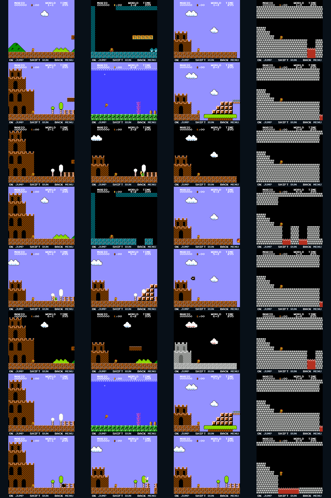

> **Super Mario Bros. for the NumWorks calculator**, part of [NumPlay](https://github.com/Mason363/NumPlay): real games rebuilt for the NumWorks. It comes as its own app: get `SuperMarioBros.nwa` from the [latest release](https://github.com/Mason363/NumWorks-Super-Mario-Bros/releases/latest).

  

<h1 align="center">Super Mario Bros.</h1>

  <b>The 1985 classic, on the NumWorks calculator.</b> 
  All 32 stages, from World 1-1 to Bowser's last castle, run by the game's own logic.

  <a href="https://github.com/Mason363/NumWorks-Super-Mario-Bros/releases/latest/download/SuperMarioBros.nwa"><b>Download SuperMarioBros.nwa</b></a>
  &nbsp;·&nbsp; <a href="#controls">Controls</a>

  

## Highlights

* **The real game:** not a lookalike. The game's own code, rewritten in C by [SMB-Vanilla](https://github.com/nukep/SMB-Vanilla), runs Nintendo's levels, enemies and graphics. Mario runs, jumps and swims exactly as on the NES.
* **All of it:** 8 worlds and 32 stages, warp zones, coin rooms, vines, Bowser, the princess and the second quest. One or two players, Mario and Luigi taking turns.
* **Pixel for pixel:** the NES picture at its own size, 60 game steps a second.
* **Saved:** Home saves your game, and it opens paused next time.

<table>
  <tr>
    <td align="center"> The title</td>
    <td align="center"> The controls</td>
  </tr>
  <tr>
    <td align="center"> World 1-2</td>
    <td align="center"> World 2-2</td>
  </tr>
  <tr>
    <td align="center"> World 3-3</td>
    <td align="center"> World 8-4</td>
  </tr>
  <tr>
    <td align="center"> The pause menu</td>
    <td align="center"> All 32 stages</td>
  </tr>
</table>

## How to install

1. Download [SuperMarioBros.nwa](https://github.com/Mason363/NumWorks-Super-Mario-Bros/releases/latest/download/SuperMarioBros.nwa).
2. Plug your NumWorks calculator into your computer and open [my.numworks.com/apps](https://my.numworks.com/apps) in Google Chrome or Microsoft Edge.
3. Drop the file there and follow the steps.

It runs on the N0110, N0115 and N0120 with Epsilon 23.2 or newer.

## Controls

| Key | What it does |
| --- | --- |
| Arrows (or 4 6 8 2) | Move, duck, climb vines, go down pipes |
| OK (or 5) | A: jump, swim |
| shift (or 0) | B: run, throw fireballs |
| EXE | Start: start, pause |
| alpha | Select: 1 or 2 players |
| Back | Menu: resume, new game, controls, quit |
| Home | Save and quit |

The line at the bottom of the screen shows the keys that matter at that moment.

## Good to know

* **As on a television:** the NES drew 240 rows, and a television hid the top and bottom 8. The calculator shows the same 224 rows, with the keys underneath.
* **Saves:** your game is saved when you pause, every 10 seconds and when you quit. Installing the app again erases it.
* **Continue:** after a game over, hold OK and press EXE on the title to start again from the world you reached, as on the NES.
* **No sound:** the calculator has no speaker.
* SMB-Vanilla's few [differences from the NES](https://github.com/nukep/SMB-Vanilla/blob/20f4e02614412f9dbd407dd4e4fab4ade5eb79da/docs/differences.md) apply: no lag frames.

## Building

`make` builds `output/SuperMarioBros.nwa` (needs `arm-none-eabi-gcc` and Node.js for nwlink), `make check` links it as the calculator does, and `make test` plays all 32 stages on a computer. Where the engine and data come from is in [vendor/UPSTREAM.md](vendor/UPSTREAM.md) and [assets/README.md](assets/README.md).

## Credits

Super Mario Bros. is Nintendo's game (1985). Not affiliated with Nintendo.

* **[Bobydeluxe](https://github.com/Bobydeluxe)** made this port.
* **[SMB-Vanilla](https://github.com/nukep/SMB-Vanilla)** by nukep: the game's logic in C (GPL-3.0), in `vendor/smbcore`.
* **The levels, tables and graphics are Nintendo's:** rebuilt from doppelganger's annotated disassembly (kept in [MitchellSternke/SuperMarioBros-C](https://github.com/MitchellSternke/SuperMarioBros-C)) and the pattern table kept in [threecreepio/smb-glitchedworlds](https://github.com/threecreepio/smb-glitchedworlds), checked against the original NTSC game. The icon is the game's Mario, from the [Super Mario Wiki](https://www.mariowiki.com/File:SMB_Smallmario.png).
* The tests replay a run from [nathsou/smb](https://github.com/nathsou/smb) (its first three stages by HappyLee and Mars608, TASVideos).

Part of [NumPlay](https://github.com/Mason363/NumPlay).

## License

GPL-3.0, as the engine is: see `LICENSE`. It covers the code (`src/`, `vendor/`, `common/`, `tools/`, `tests/`). The game's levels, graphics and the icon's sprite are Nintendo's and stay Nintendo's; the GPL doesn't cover them.
